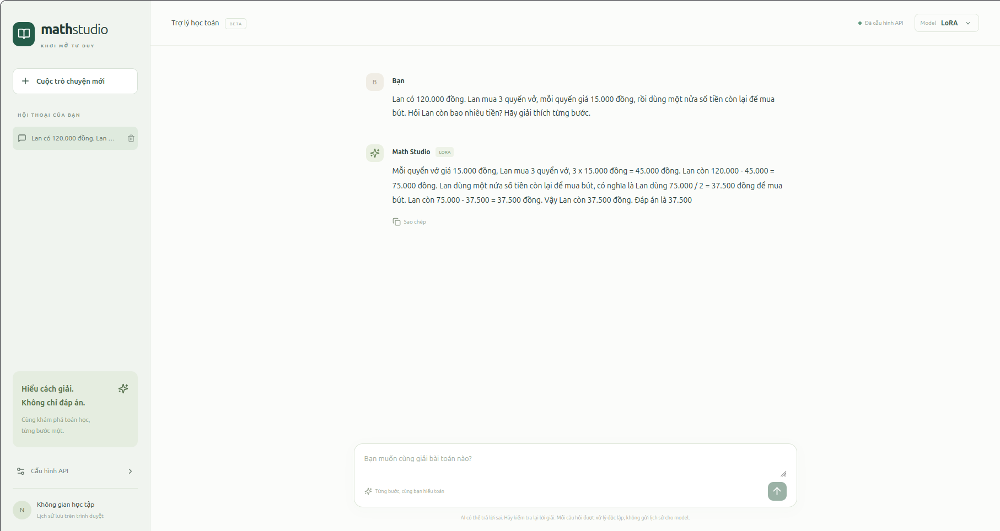
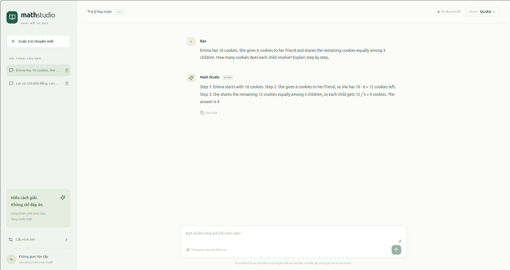

# Math Studio

Chatbot học toán sử dụng **Llama 3.2 1B Instruct**, fine-tune trên **MathInstruct** bằng **LoRA** và **QLoRA**. Web UI chạy trên máy local, kết nối tới model trên GPU Kaggle qua FastAPI và ngrok.

Giao diện hỗ trợ chọn model, hiển thị lời giải và công thức toán, sao chép đáp án và lưu lịch sử hội thoại trên trình duyệt.

## Giao diện

### LoRA · Tiếng Việt



### QLoRA · Tiếng Anh



## Chạy model trên GPU Kaggle

Các notebook nằm trong [notebooks/](notebooks/). Chọn notebook theo mục đích:

| Notebook | Dùng để làm gì? |
|---|---|
| [web-ui-peft.ipynb](notebooks/web-ui-peft.ipynb) | Khởi động hai server LoRA/QLoRA, gateway và ngrok để web UI gọi model |
| [inference-lora-qlora.ipynb](notebooks/inference-lora-qlora.ipynb) | Tải từng adapter và thử các bài toán trực tiếp trong notebook, không cần web UI |
| [full-training.ipynb](notebooks/full-training.ipynb) | Fine-tune LoRA/QLoRA, chạy validation và lưu adapter cùng MLflow tracking |
| [test-base-tuned-models.ipynb](notebooks/test-base-tuned-models.ipynb) | Chấm cùng 500 mẫu test cho Base/LoRA/QLoRA; có output các lần chạy và xuất artifact MLflow |

**Muốn chạy chatbot, dùng `web-ui-peft.ipynb`. Không cần huấn luyện lại nếu đã có adapter.**

1. Import notebook vào Kaggle, bật **Internet** và chọn **GPU T4 ×2**.
2. **Add Input** dataset chứa hai adapter đã train. Kiểm tra đường dẫn trong notebook khớp với Input của bạn; trọng số adapter không được lưu trong repo.
3. Lấy authtoken từ [ngrok](https://dashboard.ngrok.com/get-started/your-authtoken). Trong **Add-ons → Secrets** của Kaggle, lưu tên `NGROK_AUTHTOKEN` và cấp quyền cho notebook.
4. Chạy từng cell theo thứ tự: tải repo → kiểm tra GPU/adapter → cài thư viện → chạy QLoRA → chạy LoRA → chạy gateway → thử API → mở tunnel.
5. Sau mỗi lần khởi động, đọc log và chờ server sẵn sàng trước khi chạy tiếp. Hai request thử qua gateway cần trả HTTP `200`.
6. Lấy **URL gốc ngrok** được in ở cell cuối để kết nối web UI. Mở URL `/docs` để thử API từ trình duyệt.

Chỉ chạy mỗi cell khởi động server hoặc tunnel một lần trong một session để tránh trùng port. **Giữ session Kaggle hoạt động khi dùng web**; lưu notebook không giữ server chạy liên tục. Token phải giữ riêng; API hiện chưa có xác thực nên chỉ dùng URL riêng trong lúc demo.

## Chạy web UI trên máy local

Cần **Node.js 20.19+ hoặc 22.12+** tương thích Vite 7. Laptop không cần GPU.

```bash
git clone https://github.com/nhannhan2201/math-instruct-llama.git
cd math-instruct-llama/frontend
npm ci
npm run dev
```

Mở **http://localhost:5173**. Trong **Cấu hình API**, dán URL gốc ngrok của gateway, ví dụ:

```text
https://your-domain.ngrok-free.dev
```

Không thêm `/docs` hoặc `/solve`. Chọn **LoRA** hoặc **QLoRA**, nhập bài toán rồi gửi. URL và lịch sử hội thoại được lưu trên trình duyệt.

Có thể đặt URL mặc định qua `VITE_API_URL` trong `.env.local`, theo [frontend/.env.example](frontend/.env.example). Nếu đã lưu URL trên UI, cấu hình đó được ưu tiên. Xem thêm [hướng dẫn frontend](frontend/README.md).

## Luồng hoạt động

```text
Web UI · localhost:5173
          ↓ HTTPS qua ngrok
Gateway · Kaggle · port 8080
          ├─ /qlora/solve → API 8000 → QLoRA · GPU 0
          └─ /lora/solve  → API 8001 → LoRA  · GPU 1
```

Gateway chỉ chuyển tiếp request; mỗi API model tải adapter một lần khi khởi động. CORS mặc định cho phép UI ở `localhost:5173` và `127.0.0.1:5173`. Nếu đổi địa chỉ UI, cấu hình `UI_ORIGINS` rồi khởi động lại gateway.

> Model có thể trả lời sai, kể cả bài đơn giản. Hai ảnh trên là minh họa demo, không phải đánh giá accuracy. Mỗi câu hỏi được xử lý độc lập; lịch sử UI không được gửi cho model.

## Chấm tập test MathInstruct

### Kết quả

Đánh giá ngày **18/10/2026** trên **500 nhóm câu hỏi test MathInstruct** đã tách khỏi train/validation theo câu hỏi được chuẩn hóa khoảng trắng. [Notebook test](notebooks/test-base-tuned-models.ipynb) lưu output của cả ba model; số liệu dưới đây lấy từ các run MLflow tương ứng.

| Model | `test_loss` ↓ | `test_mean_token_accuracy` ↑ | `test_runtime` (giây) |
|---|---:|---:|---:|
| Base | 1,5334 | 69,00% | 38,34 |
| LoRA | **0,7904** | **79,71%** | 48,93 |
| QLoRA | 0,8110 | 79,41% | 64,60 |

Điều kiện đo: **Tesla T4**, eval batch size **1**, cùng base model/tokenizer revision và chat template, xử lý lần lượt từng model trên GPU 0. Base và LoRA dùng FP16; QLoRA dùng base **4-bit NF4 + double quantization**, compute FP16. Cả 500 lời giải được giữ đầy đủ, dài nhất **1.637 token**; không cắt về giới hạn 1.024 token của training.

- `test_loss`: cross entropy trên các token thuộc completion; prompt không đóng góp vào loss.
- `test_mean_token_accuracy`: dự đoán top-1 token tiếp theo khi cung cấp các token đúng trước đó (**teacher forcing**). TRL 1.3 tính trung bình accuracy từng mẫu với batch size 1; bảng hiển thị dưới dạng phần trăm.
- `test_runtime`: thời gian vòng đánh giá sau khi nạp model và chuẩn bị dữ liệu. Đây là một lần đo cho mỗi model, không phải latency sinh câu trả lời hay tổng thời gian chạy script.

LoRA tăng **10,71 điểm phần trăm** token accuracy so với Base; QLoRA tăng **10,41 điểm phần trăm**. Các kết quả này đo mức dự đoán lời giải mẫu, **không phải tỷ lệ bài toán giải đúng**. Chưa có đánh giá đáp án cuối từ lời giải model tự sinh.

### Chạy lại

Import [notebook test](notebooks/test-base-tuned-models.ipynb) lên Kaggle, bật Internet/GPU, thêm hai adapter làm Input và kiểm tra đường dẫn. Sau khi cài `requirements.txt`, chạy lần lượt từ thư mục gốc repo:

```bash
CUDA_VISIBLE_DEVICES=0 python -m src.test --method base
CUDA_VISIBLE_DEVICES=0 python -m src.test --method lora --adapter-path /kaggle/input/datasets/nhannhan22/models/lora_training_5c645da682df/final
CUDA_VISIBLE_DEVICES=0 python -m src.test --method qlora --adapter-path /kaggle/input/datasets/nhannhan22/models/qlora_training_6c775f8d8113/final
```

Script [src/test.py](src/test.py) xác minh snapshot dữ liệu và metadata adapter, tái sử dụng split manifest (hoặc tạo lại theo thuật toán đã cố định), rồi chỉ gọi `evaluate()`. Script dừng nếu mẫu vượt context của model. Mỗi lệnh tạo một run trong experiment `llama-3-math-instruct-test` ở `mlruns.db`, ghi metric và `test_protocol.json` chứa danh sách mẫu test, run ID và kết quả. `test_num_tokens` do TRL xuất là bộ đếm token training, bằng 0 trong run chỉ đánh giá; không dùng metric này để đếm token test.

Để lưu kết quả, tải **`mlruns.db` và thư mục `mlruns/`** từ Kaggle, đặt cạnh nhau trong `kaggle-test-results/`. Xem metric local bằng:

```bash
mlflow ui --backend-store-uri sqlite:///kaggle-test-results/mlruns.db --host 127.0.0.1 --port 5000
```

Mở `http://127.0.0.1:5000`, chọn experiment và Compare ba run trong giao diện Model training. Artifact URI trong database tải từ Kaggle có thể cần đổi sang đường dẫn local để xem artifact trong UI.
